# Prototipos de pantallas

Diseño de referencia de las pantallas a desarrollar (ver [ENUNCIADO.md](ENUNCIADO.md)). Los datos que aparecen son de ejemplo.

## Criterios de UI

- Componentes de **Angular Material**: `mat-toolbar`, `mat-card`, `mat-form-field`, `mat-select`, `mat-table`, `mat-paginator`, `mat-chip`, `mat-badge`, `mat-snack-bar`.
- **Bootstrap** solo para grilla (`row` / `col-*`), espaciado y utilidades de texto y flex.
- Evitar CSS propio en los componentes.
- Todas las pantallas comparten una barra superior: marca, links a Productos y Cargar producto (este último solo para administradores), carrito con la cantidad de unidades y botón Ingresar (o nombre del usuario y Salir, si hay sesión). Ver [Flujos y reglas transversales](#flujos-y-reglas-transversales).

## Pantallas

| # | Pantalla | Ruta sugerida | Requisito |
| --- | --- | --- | --- |
| 1 | Ingresar (signin) | `/ingresar` | Requerido |
| 2 | Crear cuenta (signup) | `/registro` | Requerido |
| 3 | ~~Recuperar contraseña~~ | — | Opcional, **descartada** |
| 4 | Listado de productos | `/productos` | Requerido |
| 5 | Detalle de producto | `/productos/:id` | Requerido |
| 6 | Mi pedido (carrito) | `/carrito` | Requerido |
| 7 | Cargar producto (solo admin) | `/productos/nuevo` | Opcional |
| 8 | Pedido confirmado | `/pedidos/:id/confirmacion` | Requerido (resultado de "Ver pedido") |

> Las imágenes reflejan las reglas de [Flujos y reglas transversales](#flujos-y-reglas-transversales). Se renderizaron con Angular Material y Bootstrap a 1280 px (escritorio) y 390 px (celular). Las pantallas con sesión muestran a una compradora (Ana Gómez); la de carga muestra al administrador. Ante una diferencia entre imagen y texto, prevalecen las reglas escritas.

### 1. Ingresar

Email y contraseña (con botón para mostrarla) y link a "Registrate". No lleva "¿Olvidaste tu contraseña?" porque el recupero no se implementa (ver pantalla 3). Cuando se llega redirigido desde "Agregar" sin sesión, se muestra el aviso "Ingresá para agregar productos al carrito.":

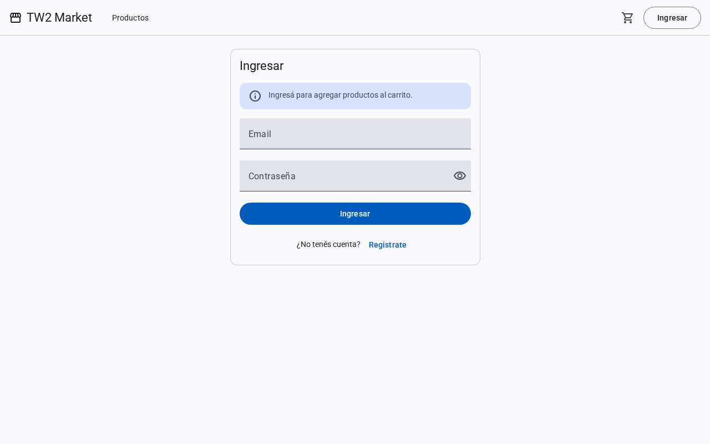

Después de registrarse, se muestra el aviso de cuenta creada:

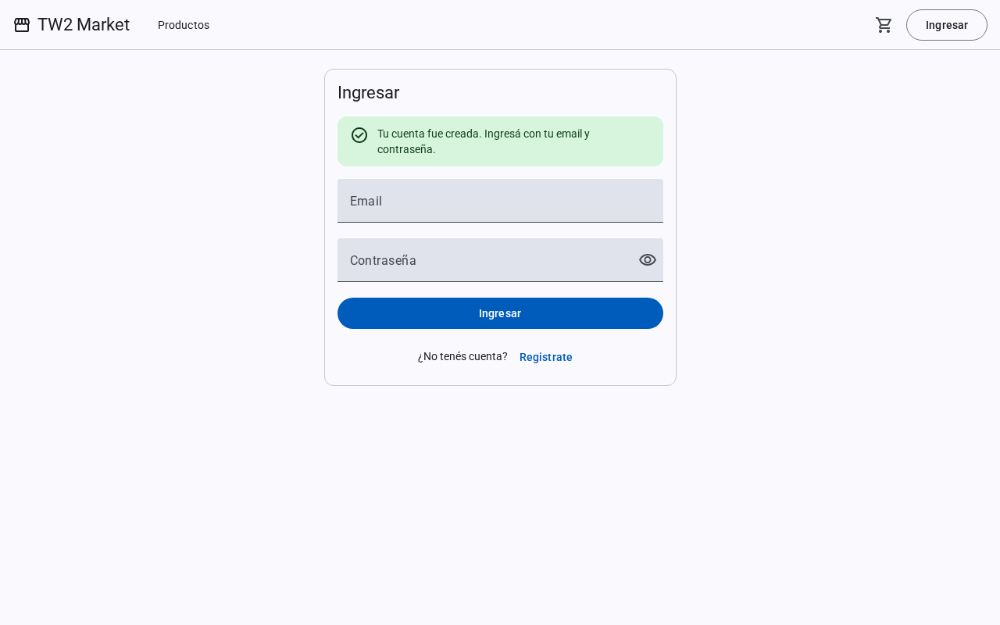

### 2. Crear cuenta

Nombre, apellido, email, dirección (aclara que es la de envío de los pedidos), contraseña y repetir contraseña. Debajo, un checklist que marca en vivo cada regla de complejidad cumplida. Si el email ya está registrado, el campo muestra "Ya existe una cuenta con este email". Si las contraseñas no coinciden, lo indica el segundo campo.

Reglas de complejidad (confirmadas; las mismas en frontend y backend): al menos 8 caracteres, una mayúscula, una minúscula, un número y un símbolo.

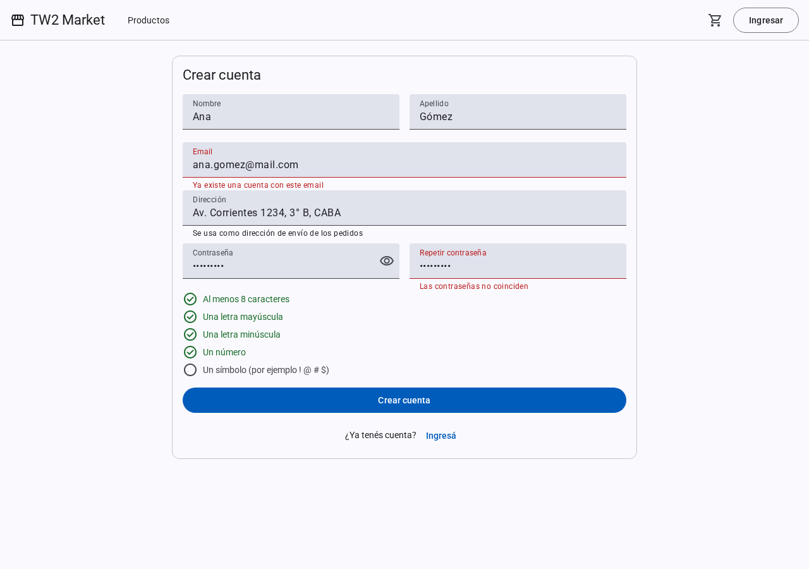

### 3. Recuperar contraseña (descartada)

Es opcional en el enunciado y no se implementa. Sin un envío real de emails, el flujo quedaría como un botón que no hace nada, así que no hay pantalla, ruta, endpoint ni link desde Ingresar.

### 4. Listado de productos

Buscador por nombre, filtro por clasificación y grilla de cards con nombre, clasificación, descripción y precio. Cada card tiene "Ver detalle" y "Agregar" al carrito, este último deshabilitado y con la leyenda "Sin stock" si no hay unidades. Con pocas unidades, se avisa "Últimas N unidades". Paginado de 6 productos por página.

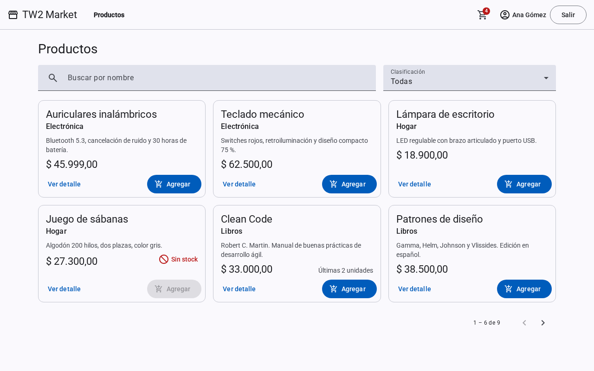

Sin resultados para la búsqueda o el filtro:

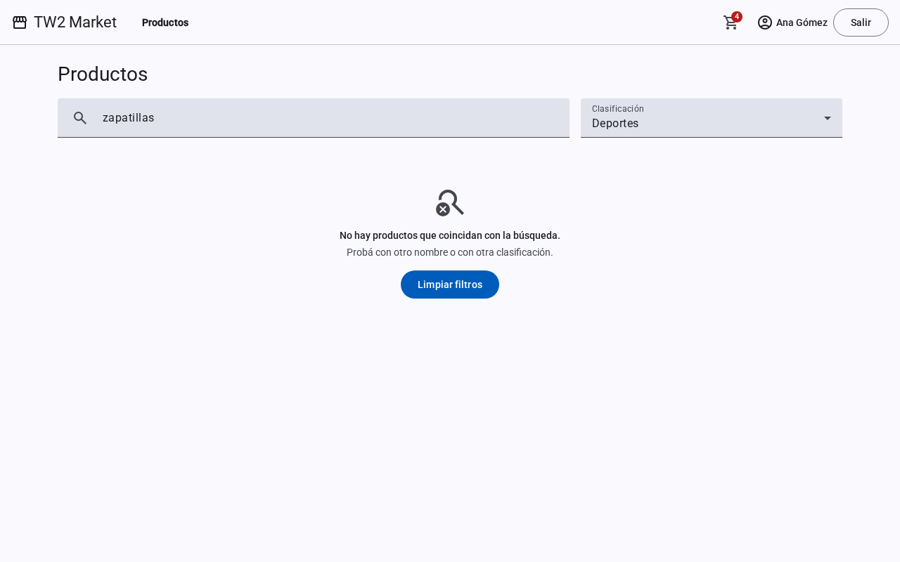

En celular las cards pasan a una columna y los links de la barra pasan a un menú (botón hamburguesa), para que sigan siendo accesibles:

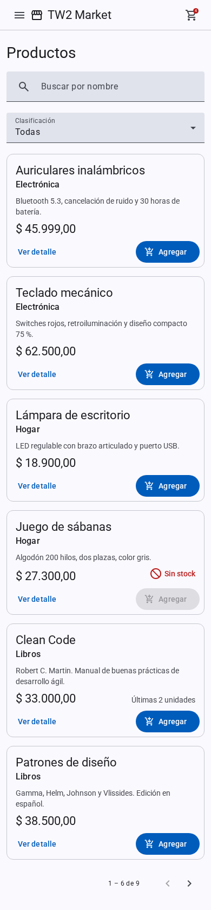

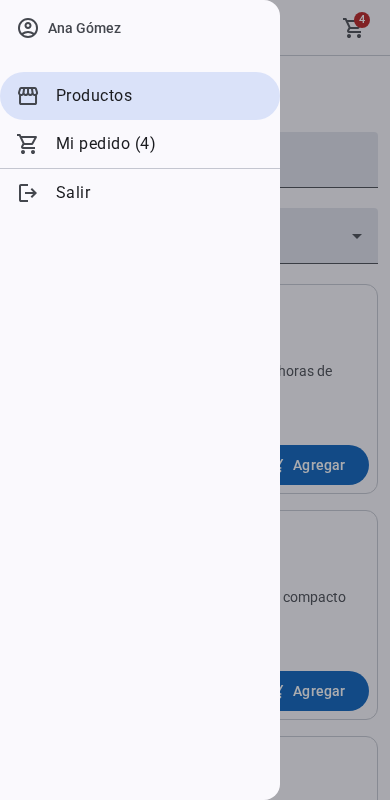

### 5. Detalle de producto

Nombre, clasificación, descripción, precio y stock disponible, con selector de cantidad (de 1 al stock disponible) y "Agregar al carrito". Sin stock, se muestra "Sin stock" y el botón queda deshabilitado. Si el producto no existe, se muestra "Producto no encontrado" con un link al listado. Al agregar, un snackbar confirma la acción y ofrece "Ver carrito":

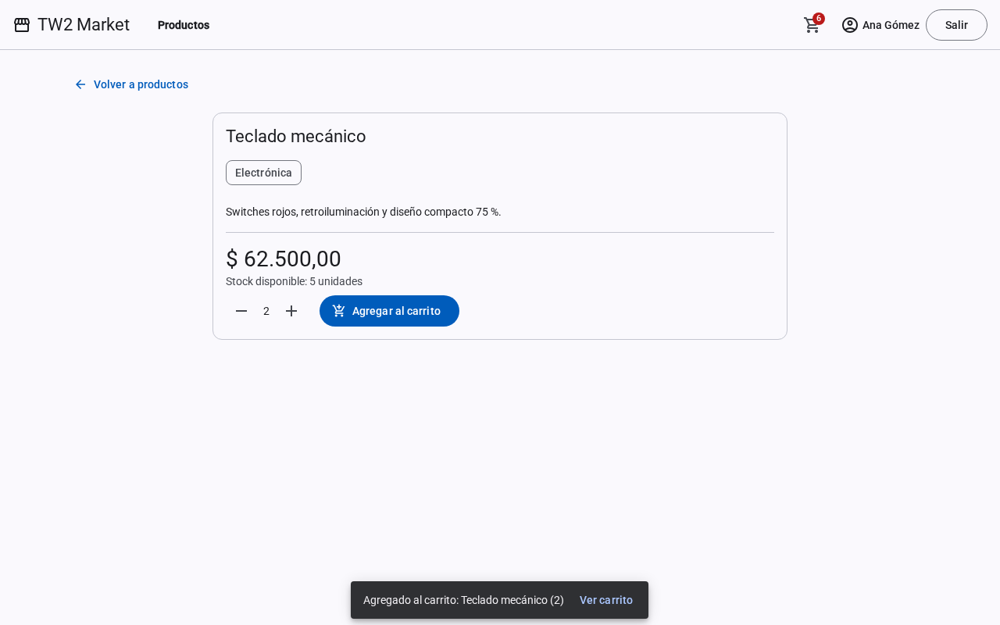

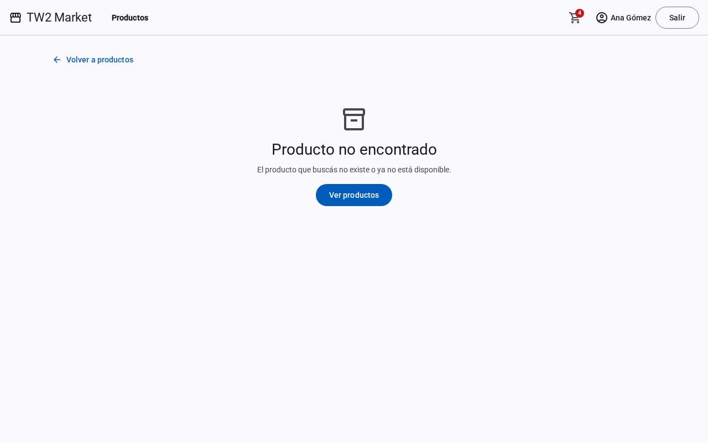

### 6. Mi pedido

Tabla con producto, precio unitario, cantidad (+/−, con tope en el stock), subtotal y quitar. A la derecha (abajo en celular), el resumen con total, dirección de envío del usuario, "Confirmar pedido" y "Seguir comprando". En celular la tabla se reemplaza por una card por ítem, porque 5 columnas no entran en el ancho.

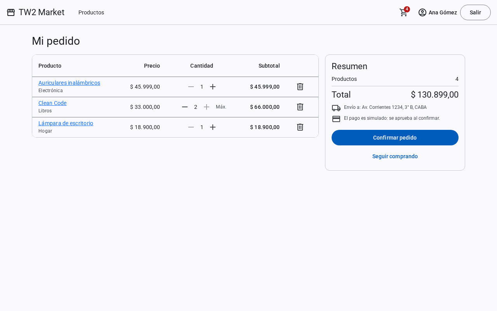

Carrito vacío:

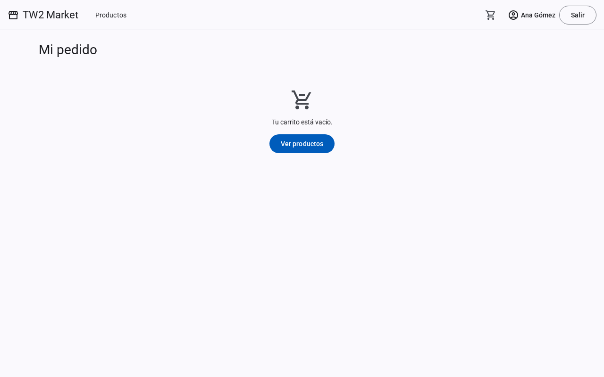

Confirmación rechazada por falta de stock (409): se marca el ítem afectado y "Confirmar pedido" queda deshabilitado hasta ajustar la cantidad:

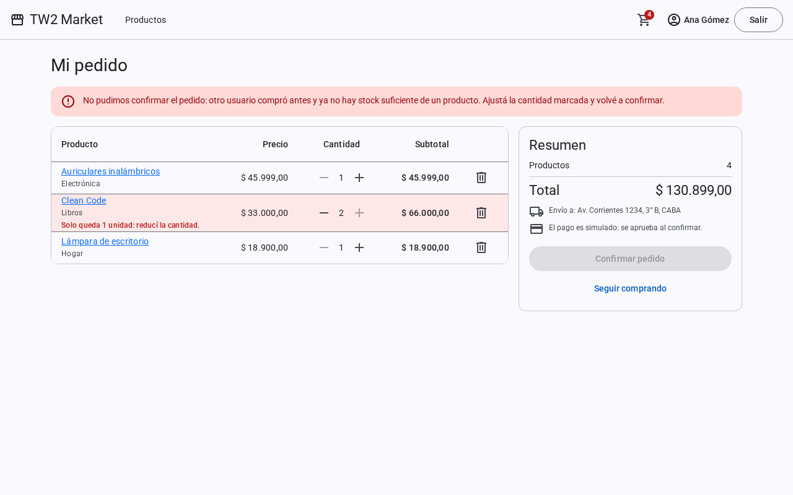

En celular, una card por ítem y el resumen debajo:

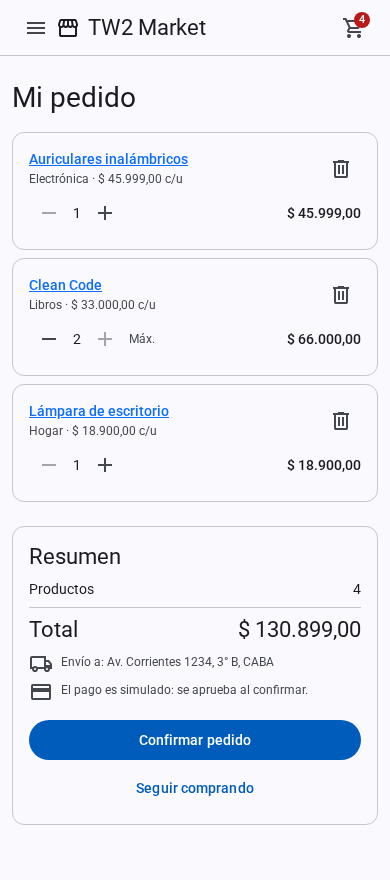

### 7. Cargar producto (opcional)

Nombre, descripción (con contador de caracteres), clasificación, precio (> 0) y stock (entero ≥ 0). Solo para administradores. Cada campo muestra su error, y "Guardar" queda deshabilitado mientras haya errores. Al guardar, se muestra un snackbar y se navega al detalle del producto creado.

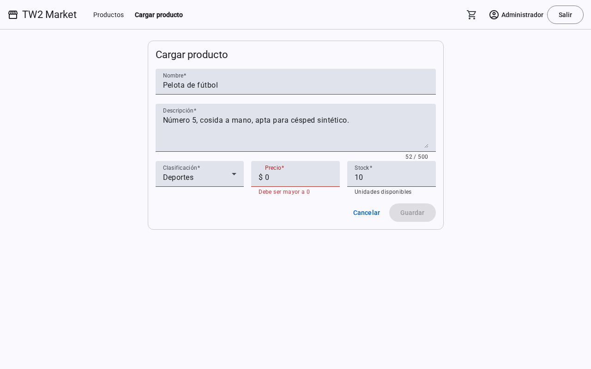

### 8. Pedido confirmado

Muestra el número de pedido, los ítems con el precio pagado, el total, la dirección de envío y un mensaje de que el pago (simulado) fue aprobado. Tiene un botón "Volver a productos". El carrito queda vacío.

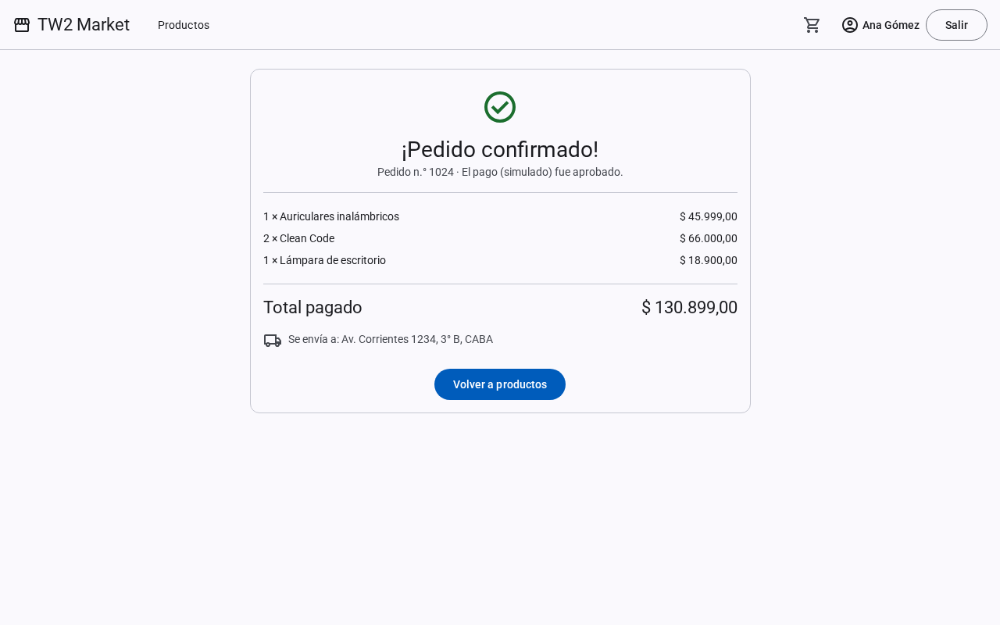

## Flujos y reglas transversales

Respuesta a las aclaraciones de la cátedra: las funcionalidades del enunciado deben ser coherentes entre sí, sin agregar alcance.

**Perfiles (simulados).**
- El rol se simula con el flag booleano `isAdmin` del usuario.
- El signup siempre crea usuarios con `isAdmin = false`. El admin se precarga con una migración (seed).
- "Cargar producto" solo se muestra y se habilita para el admin, con un guard de ruta en el cliente y 403 en el backend.
- No hay gestión de roles ni permisos avanzados.

**Sesión.**
- Con sesión iniciada, la barra muestra el nombre del usuario y "Salir". Salir borra el token y vuelve a `/productos`.
- Al ingresar se vuelve a la ruta de origen (`returnUrl`), o a `/productos` si no hay ninguna.
- Al registrarse se va a `/ingresar`, con un aviso de cuenta creada.
- Si una respuesta es 401 (sesión vencida), el cliente redirige a `/ingresar`.

**Carrito.**
- El catálogo (listado y detalle) es público.
- Para agregar al carrito hay que tener sesión. Sin ella, se redirige a `/ingresar?returnUrl=...` con el mensaje "Ingresá para agregar productos al carrito.".
- El carrito se guarda en el servidor, asociado al usuario.
- El badge cuenta unidades.

**Stock.**
- Cada producto tiene `stock`. Con 0, se muestra "Sin stock" y no se puede agregar.
- No se puede agregar ni tener en el carrito más unidades que el stock: el +/− topea y el backend valida.
- Al confirmar, el backend vuelve a validar y descuenta el stock en una transacción. Si algún ítem ya no alcanza (otro usuario compró antes), responde 409 con los productos afectados. El carrito los marca y el pedido no se crea.

**Pedido.**
- "Confirmar pedido" crea el pedido con el precio de cada producto en ese momento, simula el pago (siempre aprobado), vacía el carrito y navega a la pantalla 8.
- El botón se deshabilita mientras se procesa, para evitar un doble envío.
- No hay historial de pedidos: excede el enunciado.

**Productos.** Solo hay alta. Editar o eliminar productos no está en el enunciado y no se implementa.

**Clasificaciones.** Son una lista fija, la misma para el filtro y para el formulario de carga. Las expone el backend (o una constante compartida), no se escriben en cada pantalla.

**Feedback y errores.**
- Snackbar al agregar al carrito ("Agregado: X", con acción "Ver carrito"), al guardar un producto y ante errores del servidor.
- Indicador de carga mientras se espera una respuesta.
- Búsqueda sin resultados: "No hay productos que coincidan" y un botón para limpiar los filtros.
- Ruta inexistente: una pantalla 404 con un link a productos.
- Formularios: un mensaje por campo y botón de envío deshabilitado mientras haya errores.

**Navegación.**
- La búsqueda, el filtro y la página del listado viajan en la URL (query params), así "Volver a productos" los conserva.
- En celular, los links de la barra pasan a un menú.

**Accesibilidad.** Los botones que solo tienen ícono (+/−, quitar, carrito, menú) llevan `aria-label`, y el badge del carrito se anuncia como texto.

## Endpoints que van a necesitar las pantallas

| Pantalla | Endpoint sugerido |
| --- | --- |
| Ingresar | `POST /api/auth/signin` → `{ accessToken }` |
| Crear cuenta | `POST /api/auth/signup` (409 si el email existe) |
| Listado | `GET /api/products?search=&classification=&page=&limit=` (público) |
| Detalle | `GET /api/products/:id` (público, 404 si no existe) |
| Clasificaciones | `GET /api/classifications` (público) |
| Carrito | `GET /api/cart`, `POST /api/cart/items`, `PATCH` / `DELETE /api/cart/items/:productId` (con sesión; 409 si se supera el stock) |
| Confirmar pedido | `POST /api/pedidos` (con sesión; 409 si falta stock) |
| Pedido confirmado | `GET /api/pedidos/:id` (solo el dueño del pedido) |
| Cargar producto | `POST /api/products` (solo admin, 403 si no) |
